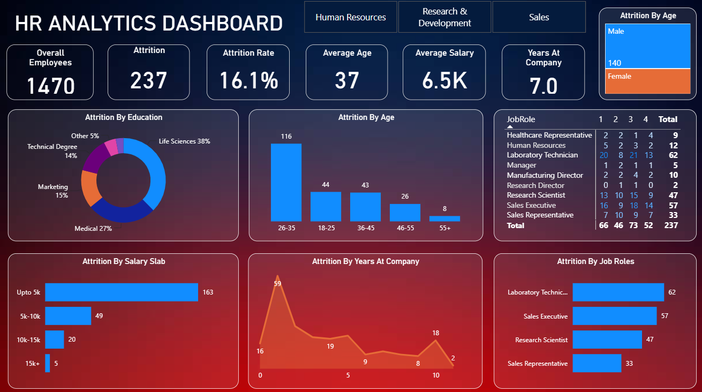

# HR Analytics Dashboard

An interactive Power BI dashboard built to analyze workforce demographics, employee attrition, compensation trends, and job satisfaction metrics using the comprehensive HR Analytics dataset.

## 📊 Project Overview
This project explores employee data to uncover patterns and actionable insights regarding workforce retention, salary slabs, overtime impact, and factors driving employee turnover.

## 📁 Repository Structure
- `HR_Analytics.csv`: The primary dataset containing employee records, demographic details, compensation, and performance metrics.
- `Power bi.pbix`: The Power BI dashboard file featuring interactive visualizations and filters.

## 🔑 Key Metrics & Insights
- **Attrition & Turnover:** Analysis of voluntary vs. involuntary attrition rates, identifying departments and roles with higher turnover risks.
- **Compensation & Salary Slabs:** Breakdown of monthly income distribution, salary slabs, and percentage salary hikes across different job levels.
- **Employee Demographics:** Exploration of age groups, gender distribution, marital status, and distance from home.
- **Workplace Satisfaction & Overtime:** Impact of overtime, work-life balance, environment satisfaction, and job involvement on employee retention.

## 🛠️ Tools & Technologies Used
- **Data Visualization:** Power BI
- **Data Analytics & Processing:** CSV / Data Modeling
- **Version Control:** Git & GitHub

## 🚀 How to View
1. Download the `Power bi.pbix` file and the `HR_Analytics.csv` dataset.
2. Open the `.pbix` file using Power BI Desktop.
3. If prompted for data source paths, update the source link to point to your local copy of `HR_Analytics.csv`.
